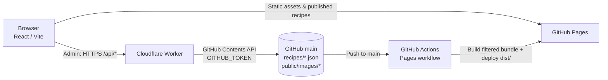
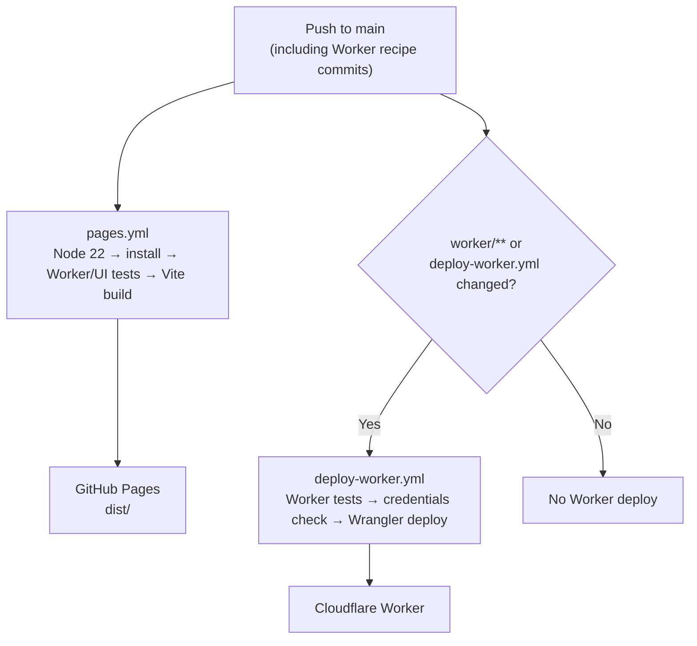

# Mom's Cookbook

A static React/Vite recipe site on **GitHub Pages**, with a password-protected **Cloudflare Worker** for authoring. GitHub is the data store: each recipe is a JSON file on `main`, and photos live in the repository. There is no database or application server for public reads.

- **Site:** https://jaruso.github.io/moms-cookbook/
- **Admin:** https://jaruso.github.io/moms-cookbook/#/admin
- **Worker:** https://moms-cookbook-api.joseph-caruso-pc.workers.dev

## Architecture



**Public reads:** `scripts/build-recipes.mjs` runs before each Vite build, reads `recipes/*.json`, and generates `src/public-recipes.json` with only records where `draft !== true` and `hidden !== true`. The React client searches and filters this bundled data locally—no API call for browsing, category selection, ingredient pills, or cooking-time filters. A recipe's print button uses browser print styles.

**Admin writes:** The frontend signs in through the Worker, then calls authenticated endpoints to create/edit recipes or toggle visibility. The Worker validates requests, resizes nothing (the frontend resizes photos to JPEG), and uses a fine-grained GitHub token to commit recipe JSON and optional images to `main`. Each resulting push causes the Pages workflow to rebuild; API success does **not** mean the public site has already updated.

**Client state:** A signed admin session token is kept in `sessionStorage`. Unsaved form text and ingredient rows are backed up in `localStorage` after ~1 second of inactivity, with navigation warnings and recovery prompts. Local recovery is device/browser-specific and **does not** store passwords, bearer tokens, or unsaved photo files. Saving a GitHub-backed draft is separate from local recovery.

## Data model

- `recipes/<id>.json` is the source of truth; `id` is generated from the title plus a short random suffix and is stable across edits.
- Common fields: `id`, `title`, `description` (ordered string paragraphs), `category`, `prepMinutes`, `cookMinutes`, `servings`, `ingredients` (string array), `steps` (string array), `image` (relative path or `null`), `draft`, `hidden`, `createdAt`, and `updatedAt` (ISO UTC).
- `draft: true` allows incomplete entries. `ingredientDraftRows` retains unfinished structured amount/unit/name inputs while editing. Publishing removes that draft-only field and sets `draft: false`.
- `hidden: true` hides an otherwise published recipe. Older records without `draft` or `hidden` remain visible.
- `description` accepts textarea text or an array on input; the Worker normalizes it to ordered paragraphs. Existing single-string descriptions remain readable.
- Images are stored at `public/images/...jpg` and referenced in JSON as `images/...jpg`.

**Visibility is not privacy.** The GitHub repository is public, so hidden/draft JSON and uploaded photos can be accessed there. The build only excludes them from the public **site bundle**; previously published photo URLs may remain available.

## Worker API contract

Base URL: `https://moms-cookbook-api.joseph-caruso-pc.workers.dev`. Requests and responses use JSON. All endpoints except health and login require `Authorization: Bearer <token>`; tokens are HMAC-signed with `SESSION_SECRET` and expire after **4 hours**.

| Method | Endpoint | Request | Success response |
| --- | --- | --- | --- |
| `GET` | `/api/health` | None; public | `200 {"ok":true}` |
| `POST` | `/api/login` | `{"password":"..."}` | `200 {"token":"..."}` |
| `GET` | `/api/recipes` | Bearer token | `200 {"recipes":[...]}`; includes hidden/draft records and each file's `sha` |
| `POST` | `/api/recipes` | Recipe payload + Bearer token | `201` created recipe |
| `PUT` | `/api/recipes/:id` | Recipe payload **and current `sha`** | `200` saved recipe + new `sha` |
| `PATCH` | `/api/recipes/:id/visibility` | `{"hidden":true,"sha":"<40-char SHA>"}` | `200` updated recipe + new `sha` |

`OPTIONS` supports browser CORS preflight. There is no delete endpoint and no public recipe-list API; visitor pages use the static bundle.

### Create / update payload

```json
{
  "title": "Sunday Sauce",
  "description": "A family favorite.\n\nServe with pasta.",
  "category": "Dinner",
  "prepMinutes": 15,
  "cookMinutes": 45,
  "servings": "4",
  "ingredients": ["2 tbsp olive oil", "3 cloves garlic"],
  "steps": ["Warm the oil.", "Add garlic and simmer."],
  "draft": false,
  "imageBase64": null,
  "removePhoto": false
}
```

For `PUT`, supply the same fields **plus** `"sha": "<latest GitHub file SHA>"` from `GET /api/recipes`. A mismatched SHA returns **409 Conflict** to prevent overwriting newer changes. For new recipes, the server generates `id` and timestamps; the UI refreshes the admin list to obtain the new SHA when needed.

**Validation and optional fields:**

| Field | Constraint |
| --- | --- |
| `title` / `category` | Required for publishing; max 120 / 60 characters. |
| `ingredients` / `steps` | For publishing, 1–60 ingredients (250 characters each) and 1–35 directions (1,000 characters each). Arrays of strings. |
| `description` | Optional; at most 30 paragraphs, 2,000 characters per paragraph, 12,000 total. |
| `prepMinutes` / `cookMinutes` | Integer 0–999 or `null`. `servings` optional, max 40 characters. |
| `draft` | Boolean. Drafts can have blank title/category and empty ingredient/direction arrays; include `ingredientDraftRows` (1–60 objects containing `amount`, `unit`, `customUnit`, `name`). |
| `imageBase64` / `removePhoto` | Optional base64 JPEG under 1 MB, **or** `removePhoto: true`, never both. No photo field is required when keeping the existing image. |

Ingredient rows are serialized to strings (such as `"2 cups flour"`) for published recipes; the client preserves older ingredient wording when editing. The frontend converts selected photos to JPEG before upload.

Errors are JSON `{"error":"..."}`, with common statuses **400** (validation), **401** (missing/invalid login or bearer token), **403** (disallowed origin), **404** (not found), **409** (stale SHA), **413** (oversized request), **502** (GitHub upstream error), and **503** (missing Worker runtime secrets). Non-health requests with unsupported methods may return **405**.

CORS origins are explicitly allowed in `worker/src/index.js`: `https://jaruso.github.io` and `http://localhost:5173`. CORS does not replace authentication.

## CI/CD



| Workflow | Trigger | Actions |
| --- | --- | --- |
| [`pages.yml`](.github/workflows/pages.yml) | **Every** push to `main`; manual `workflow_dispatch` | Node 22, `npm install`, Worker + ingredient + description + visibility + recovery + search tests, `npm run build`, upload `dist/`, deploy to GitHub Pages. |
| [`deploy-worker.yml`](.github/workflows/deploy-worker.yml) | Push to `main` changing `worker/**` or the Worker workflow; manual `workflow_dispatch` | Node 22, Worker API tests, credential check, `cloudflare/wrangler-action@v4` with `workingDirectory: worker` and `command: deploy`. |

The Worker workflow does **not** rerun when only `recipes/`, `src/`, or documentation changes. The Pages workflow runs on these commits. Neither workflow injects Worker runtime secrets: they must already exist in Cloudflare.

## Configuration and secrets

### GitHub repository → Settings → Secrets and variables → Actions

| Name | Type | Used by | Purpose |
| --- | --- | --- | --- |
| `VITE_API_URL` | **Variable** (public) | Pages build | Worker HTTPS base URL, without trailing slash. Optional with current `pages.yml`: it falls back to the production Worker URL above. |
| `CLOUDFLARE_ACCOUNT_ID` | **Secret** | Worker deploy workflow | Cloudflare account ID for automated deployment. |
| `CLOUDFLARE_API_TOKEN` | **Secret** | Worker deploy workflow | Cloudflare API token with Workers deployment permissions in the target account. |

`VITE_API_URL` is compiled into the browser bundle and is **not a secret**. The GitHub deployment secrets are needed only when running the Cloudflare workflow, not for manual Wrangler deployment.

### Cloudflare Worker → runtime bindings

| Name | Storage | Purpose |
| --- | --- | --- |
| `ADMIN_PASSWORD` | **Worker secret** | Shared admin login password; no email-based reset. |
| `SESSION_SECRET` | **Worker secret** | Key for HMAC signing/validating 4-hour session tokens; use an independent random value. |
| `GITHUB_TOKEN` | **Worker secret** | Fine-grained GitHub PAT scoped to `Jaruso/moms-cookbook` with **Contents: Read and write**; used for recipe and image commits. |
| `REPO_OWNER` / `REPO_NAME` | Nonsecret `[vars]` in `worker/wrangler.toml` | `Jaruso` / `moms-cookbook`. |

Configure production Worker secrets from `worker/` (Wrangler prompts for each value; do not commit secrets):

```bash
cd worker
npx wrangler login
npx wrangler secret put ADMIN_PASSWORD
npx wrangler secret put SESSION_SECRET
npx wrangler secret put GITHUB_TOKEN
```

Generate long, independent secrets/passwords (for example, `openssl rand -base64 32`). Give the admin password privately; it is **not** a GitHub Actions secret. Rotate `ADMIN_PASSWORD` to change the password and `SESSION_SECRET` to invalidate existing sessions. Plan to renew the GitHub PAT before expiration.

## Deployment

### Initial setup

1. Install **Node.js 22+** and authenticate Wrangler (`cd worker && npx wrangler login`).
2. Create the GitHub fine-grained PAT with Contents read/write, and set the three Cloudflare **runtime secrets** above.
3. Deploy the Worker (manual command below) and verify `GET /api/health`.
4. In GitHub **Settings → Pages**, select **GitHub Actions** as the source.
5. Configure the GitHub variable and secrets above. Run the Pages workflow and Worker workflow once to verify deployment.

### Manual triggers (still use GitHub Actions)

In **Actions**, open **Deploy GitHub Pages** or **Deploy Cloudflare Worker** and select **Run workflow**. This is a manual trigger but still uses the corresponding CI/CD pipeline.

### Fully manual Worker deployment (no GitHub Actions)

```bash
git pull
cd worker
npx wrangler login        # if needed
npx wrangler deploy
```

Uses `worker/wrangler.toml` and the existing Cloudflare runtime secrets. If this is a new Worker, set those secrets as shown above.

### Fully manual frontend deployment (without the Pages workflow)

```bash
git pull
npm install
VITE_API_URL=https://moms-cookbook-api.joseph-caruso-pc.workers.dev npm run build
npx --yes gh-pages -d dist -b gh-pages
```

This publishes the generated `dist/` to a `gh-pages` branch. **Important:** The repository currently uses the GitHub Actions Pages source. To serve a manually pushed build, change **Settings → Pages → Build and deployment → Source** to **Deploy from a branch**, select `gh-pages` and `/(root)`, then save. To resume the current CI-based deployment, switch the Pages source back to **GitHub Actions**. Avoid switching deployment modes unless you actually need to bypass CI; recipe edits will not rebuild the manually published site until you run these commands again.

## Local development

```bash
npm install
npm run dev
```

The `predev` and `prebuild` scripts regenerate the visible-only `src/public-recipes.json` before Vite runs; `dist/` and the generated JSON are gitignored.

For a local admin API, add a gitignored `.env.local` at the repository root:

```dotenv
VITE_API_URL=http://127.0.0.1:8787
```

Provide gitignored `worker/.dev.vars` with `ADMIN_PASSWORD`, `SESSION_SECRET`, and `GITHUB_TOKEN`, then start the Worker in another terminal:

```bash
cd worker
npx wrangler dev
```

**Caution:** With a real `GITHUB_TOKEN`, local Worker writes still commit to the configured GitHub repository. Use a test repository/token when exercising writes you do not want in production.

Run the same tests and production build locally:

```bash
node --test worker/src/index.test.js src/*.test.js
npm run build
```

## Repository map and limitations

```text
recipes/                     Recipe JSON source of truth (main)
public/images/               Uploaded recipe JPEGs
src/App.jsx                  React pages, editor, search, print UI
src/recipe-search.js         Client-side search and ingredient-pill filtering
src/recovery.js              Local unsaved-form recovery
scripts/build-recipes.mjs     Visible-only bundle generator
worker/src/index.js          Cloudflare API, auth, validation, GitHub writes
worker/wrangler.toml         Worker name, entrypoint, nonsecret bindings
.github/workflows/           Pages and Worker CI/CD
```

- **Updates are eventually visible:** an API write creates a GitHub commit; the next Pages build/deploy publishes it. Check Actions if a recipe has not appeared.
- **No delete endpoint:** hiding/drafting preserves the JSON file. Replaced/removed photo files are not automatically cleaned up.
- **Photo writes are not atomic:** uploading a photo and saving its recipe are separate GitHub commits. A failed recipe write can leave an orphan image.
- **GitHub Contents API limit:** the admin listing uses the directory endpoint (up to ~1,000 files); a larger collection would need pagination/indexing or another storage strategy.
- **No confidential drafts:** hidden/draft entries are still in the public GitHub repository.
